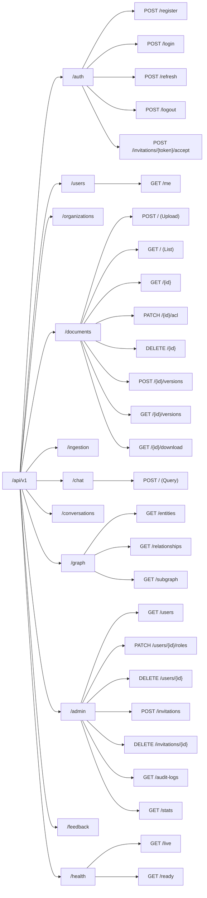

# API Documentation — Enterprise Knowledge Intelligence Platform

> **Phase 0 Design Document** — Authoritative REST API contracts, Pydantic schemas, validation rules, authorization requirements, and error behaviors for implementation.

---

## Table of Contents

1. [API Overview & Protocol Conventions](#1-api-overview--protocol-conventions)
2. [Common Response Envelopes & Error Models](#2-common-response-envelopes--error-models)
3. [Authentication & Session Endpoints](#3-authentication--session-endpoints)
4. [Organization & Membership Endpoints](#4-organization--membership-endpoints)
5. [Document Management & Versioning Endpoints](#5-document-management--versioning-endpoints)
6. [Ingestion Job Monitoring Endpoints](#6-ingestion-job-monitoring-endpoints)
7. [Chat & Hybrid RAG Query Endpoints](#7-chat--hybrid-rag-query-endpoints)
8. [Knowledge Graph Explorer Endpoints](#8-knowledge-graph-explorer-endpoints)
9. [Administration & User Management Endpoints](#9-administration--user-management-endpoints)
10. [Feedback Endpoint](#10-feedback-endpoint)
11. [Liveness & Readiness Health Endpoints](#11-liveness--readiness-health-endpoints)
12. [Complete Pydantic Schema Index](#12-complete-pydantic-schema-index)
13. [API Security & Authorization Enforcement](#13-api-security--authorization-enforcement)

---

## 1. API Overview & Protocol Conventions

The Enterprise Knowledge Intelligence Platform exposes a RESTful JSON API implemented in **FastAPI** (Python 3.12). Every endpoint adheres to strict typing, Pydantic v2 validation, predictable HTTP status codes, and server-side tenant isolation.

| Property | Standard Specification |
|---|---|
| **Base URL** | `/api/v1` |
| **Media Types** | `application/json` (default), `multipart/form-data` (file uploads) |
| **Authentication** | Bearer JWT token in HTTP `Authorization` header |
| **Tenant Context** | `X-Organization-ID` HTTP header (UUID) serves strictly as a *membership selection hint*; tenant context is derived from verified server-side membership |
| **Request Correlation** | `X-Request-ID` header returned on all responses for tracing and audit logging |
| **Pagination** | Offset-based with `limit` (max 100) and `offset` |

### Endpoint Overview Map



---

## 2. Common Response Envelopes & Error Models

### 2.1 Standard Success Envelope
```json
{
  "status": "success",
  "data": { ... },
  "meta": {
    "total": 120,
    "limit": 20,
    "offset": 0,
    "request_id": "550e8400-e29b-41d4-a716-446655440000"
  }
}
```

### 2.2 Standard Error Envelope
```json
{
  "status": "error",
  "error": {
    "code": "FORBIDDEN",
    "message": "User lacks the required role permission: documents:delete",
    "details": null,
    "request_id": "550e8400-e29b-41d4-a716-446655440000"
  }
}
```

### 2.3 HTTP Status Codes & Error Meanings
| Code | Machine Code (`code`) | Semantic Usage |
|---|---|---|
| `200` | — | Successful query, retrieval, or update |
| `201` | — | Resource created (upload, user, org, feedback) |
| `204` | — | Resource deleted / empty body |
| `400` | `INVALID_REQUEST` | Malformed payload, invalid file signature, duplicate slug |
| `401` | `UNAUTHORIZED` | Missing, malformed, or expired access token |
| `403` | `FORBIDDEN` | Authenticated user lacks functional RBAC role permission |
| `404` | `NOT_FOUND` | Resource does not exist OR is intentionally masked (cross-tenant or document-ACL-denied resource probes) |
| `409` | `CONFLICT` | Unique constraint violation (email already registered, duplicate file hash) |
| `413` | `PAYLOAD_TOO_LARGE` | File exceeds maximum size threshold (50 MB) |
| `422` | `VALIDATION_ERROR` | Pydantic model validation failure on field constraints |
| `429` | `RATE_LIMITED` | Endpoint rate limit threshold exceeded |
| `500` | `INTERNAL_SERVER_ERROR` | Unhandled internal exception (masked, logged with request ID) |

---

## 3. Authentication & Session Endpoints

---

### `POST /api/v1/auth/register`
Register a new global user account and optionally bootstrap a new organization.

- **Auth:** None (Public)
- **Rate Limit:** 3 req / min per IP

**Request Body (`RegisterRequest`):**
```json
{
  "email": "alice@finova.com",
  "password": "SecurePassword123!",
  "full_name": "Alice Finova",
  "organization_name": "Finova Technologies"
}
```

**Response `201 Created` (`RegisterResponse`):**
```json
{
  "status": "success",
  "data": {
    "user_id": "11111111-0000-0000-0000-000000000001",
    "email": "alice@finova.com",
    "full_name": "Alice Finova",
    "organization": {
      "id": "22222222-0000-0000-0000-000000000001",
      "name": "Finova Technologies",
      "slug": "finova-technologies"
    },
    "access_token": "eyJhbGciOiJIUzI1NiIs...",
    "token_type": "bearer",
    "expires_in": 900
  }
}
```

---

### `POST /api/v1/auth/login`
Authenticate with email and password to receive an access token and refresh token session.

- **Auth:** None (Public)
- **Rate Limit:** 5 req / min per IP

**Request Body (`LoginRequest`):**
```json
{
  "email": "alice@finova.com",
  "password": "SecurePassword123!"
}
```

**Response `200 OK` (`TokenResponse`):**
```json
{
  "status": "success",
  "data": {
    "access_token": "eyJhbGciOiJIUzI1NiIs...",
    "token_type": "bearer",
    "expires_in": 900,
    "user": {
      "id": "11111111-0000-0000-0000-000000000001",
      "email": "alice@finova.com",
      "full_name": "Alice Finova"
    }
  }
}
```
*(Refresh token set via `HttpOnly`, `Secure`, `SameSite=Lax` cookie `ekip_refresh_token`)*

---

### `POST /api/v1/auth/refresh`
Rotate refresh token and issue a fresh 15-minute access token. Frontend implements a single-flight promise latch / mutex to serialize refresh calls from concurrent client requests. Backend uses database row-level locking (`SELECT ... FOR UPDATE`) during atomic token rotation. Strict replay detection immediately revokes the entire token family if a previously consumed token is presented.

- **Auth:** None (Consumes cookie `ekip_refresh_token` or optional JSON `refresh_token` body)
- **CSRF:** Verifies `Origin` header and requires `X-CSRF-Token` header for cookie requests.
- **Rate Limit:** 10 req / min per IP

**Response `200 OK` (`TokenResponse`):**
```json
{
  "status": "success",
  "data": {
    "access_token": "eyJhbGciOiJIUzI1NiIs...",
    "token_type": "bearer",
    "expires_in": 900
  }
}
```

---

### `POST /api/v1/auth/logout`
Revoke the current refresh token session and clear client cookies.

- **Auth:** Required (Bearer JWT or active refresh cookie)
- **CSRF:** Verifies `X-CSRF-Token` header.
- **Response `200 OK`:**
```json
{
  "status": "success",
  "data": {
    "message": "Session successfully terminated"
  }
}
```

---

### `POST /api/v1/auth/invitations/{token}/accept`
Accept an organization membership invitation.

- **Auth:** Required (Authenticated user accepting invitation)
- **Response `200 OK`:**
```json
{
  "status": "success",
  "data": {
    "organization_id": "22222222-0000-0000-0000-000000000001",
    "organization_name": "Finova Technologies",
    "roles": ["employee"]
  }
}
```

---

### `GET /api/v1/users/me`
Retrieve authenticated user profile, active tenant memberships, and assigned roles.

- **Auth:** Required (Bearer JWT)
- **Response `200 OK` (`UserMeResponse`):**
```json
{
  "status": "success",
  "data": {
    "id": "11111111-0000-0000-0000-000000000001",
    "email": "alice@finova.com",
    "full_name": "Alice Finova",
    "is_active": true,
    "memberships": [
      {
        "organization_id": "22222222-0000-0000-0000-000000000001",
        "organization_name": "Finova Technologies",
        "roles": ["org_admin"]
      }
    ]
  }
}
```

---

## 4. Organization & Membership Endpoints

---

### `POST /api/v1/organizations`
Create a new tenant organization. Authenticated user becomes its initial `org_admin`.

- **Auth:** Required
- **Request Body (`OrganizationCreateRequest`):**
```json
{
  "name": "Apex Financial",
  "description": "Asset management and hedge fund division"
}
```

---

### `GET /api/v1/organizations/current`
Get details and statistics for the active organization identified by the `X-Organization-ID` header.

- **Auth:** Required
- **Header:** `X-Organization-ID: <UUID>`
- **Response `200 OK`:**
```json
{
  "status": "success",
  "data": {
    "id": "22222222-0000-0000-0000-000000000001",
    "name": "Finova Technologies",
    "slug": "finova-technologies",
    "description": "Enterprise software and cloud services",
    "member_count": 18,
    "document_count": 24,
    "created_at": "2026-11-06T10:00:00Z"
  }
}
```

---

## 5. Document Management & Versioning Endpoints

---

### `POST /api/v1/documents`
Upload an enterprise document for ingestion. Enforces magic byte checks, MIME validation, and size bounds (50 MB).

- **Auth:** Required (`documents:create`)
- **Headers:** `X-Organization-ID: <UUID>`
- **Content-Type:** `multipart/form-data`

**Form Parameters:**
| Parameter | Type | Required | Description |
|---|---|---|---|
| `file` | UploadFile | Yes | Document file (`.pdf`, `.docx`, `.pptx`, `.txt`) |
| `title` | string | Yes | Human-readable document title |
| `department` | string | No | Department scope (e.g. `Finance`, `Engineering`) |
| `classification` | string | No | `public`, `internal` (default), `confidential`, `restricted` |
| `allowed_roles` | string (JSON array) | No | Initial ACL role names (e.g. `["analyst", "employee"]`) |
| `allowed_users` | string (JSON array) | No | Initial ACL user UUIDs (must belong to tenant) |
| `tags` | string (JSON array) | No | Searchable metadata tags |

**Response `201 Created` (`DocumentUploadResponse`):**
```json
{
  "status": "success",
  "data": {
    "id": "33333333-0000-0000-0000-000000000001",
    "title": "Project Alpha Risk Assessment",
    "filename": "Project_Alpha_Risk_Assessment.pdf",
    "mime_type": "application/pdf",
    "file_size": 2048576,
    "department": "Finance",
    "classification": "confidential",
    "status": "pending",
    "ingestion_job_id": "44444444-0000-0000-0000-000000000001",
    "created_at": "2026-11-06T12:00:00Z"
  }
}
```

---

### `GET /api/v1/documents`
List documents accessible to the authenticated user within the tenant.

- **Auth:** Required (`documents:read`)
- **Headers:** `X-Organization-ID: <UUID>`
- **Query Parameters:** `limit` (int, default 20), `offset` (int, default 0), `department`, `classification`, `status`, `search`

---

### `GET /api/v1/documents/{id}`
Retrieve complete document metadata, current version, and active ACL entries.

- **Auth:** Required (`documents:read` + ACL check)
- **Response `200 OK` (`DocumentDetailResponse`):**
```json
{
  "status": "success",
  "data": {
    "id": "33333333-0000-0000-0000-000000000001",
    "title": "Project Alpha Risk Assessment",
    "filename": "Project_Alpha_Risk_Assessment.pdf",
    "mime_type": "application/pdf",
    "file_size": 2048576,
    "file_hash": "e3b0c44298fc1c149afbf4c8996fb92427ae41e4649b934ca495991b7852b855",
    "department": "Finance",
    "classification": "confidential",
    "status": "ready",
    "current_version_id": "version-uuid-001",
    "uploaded_by": "11111111-0000-0000-0000-000000000001",
    "created_at": "2026-11-06T12:00:00Z",
    "acl": [
      {
        "grant_type": "role",
        "role_name": "analyst",
        "permission_level": "read"
      }
    ]
  }
}
```

---

### `PATCH /api/v1/documents/{id}/acl`
Update document access control list. Target must belong to document organization and enforce XOR target constraint.

- **Auth:** Required (`documents:manage_acl`)
- **Request Body (`ACLUpdateRequest`):**
```json
{
  "grants": [
    {
      "grant_type": "role",
      "role_id": "55555555-0000-0000-0000-000000000001",
      "permission_level": "read"
    },
    {
      "grant_type": "user",
      "user_id": "11111111-0000-0000-0000-000000000002",
      "permission_level": "write"
    }
  ]
}
```

---

### `POST /api/v1/documents/{id}/versions`
Upload a new revision for an existing document.

- **Auth:** Required (`documents:update` + `write` ACL permission)
- **Content-Type:** `multipart/form-data`
- **Response `201 Created` (`DocumentVersionResponse`):**
```json
{
  "status": "success",
  "data": {
    "version_id": "version-uuid-002",
    "version_number": 2,
    "file_hash": "b2c3d4e5...",
    "created_at": "2026-11-06T14:00:00Z"
  }
}
```

---

### `GET /api/v1/documents/{id}/versions`
List all revision history records for a document.

- **Auth:** Required (`documents:read` + ACL check)

---

### `GET /api/v1/documents/{id}/download`
Securely stream the original document binary.

- **Auth:** Required (`documents:read` + ACL check)
- **Behavior:** Verifies caller clearance before streaming binary stream from `storage_path`. Direct unauthenticated file URLs are prohibited.

---

### `DELETE /api/v1/documents/{id}`
Soft-delete document in PostgreSQL immediately denying access, and enqueue a durable background cleanup task to purge vectors in Qdrant, document nodes in Neo4j, and on-disk files.

- **Auth:** Required (`documents:delete`)
- **Response `204 No Content`**

---

## 6. Ingestion Job Monitoring Endpoints

---

### `GET /api/v1/ingestion/jobs/{id}`
Check status and stage progress of an asynchronous document processing job.

- **Auth:** Required (Uploader or `org_admin`)
- **Response `200 OK` (`IngestionJobResponse`):**
```json
{
  "status": "success",
  "data": {
    "id": "44444444-0000-0000-0000-000000000001",
    "document_id": "33333333-0000-0000-0000-000000000001",
    "status": "processing",
    "current_stage": "graph_construction",
    "progress_pct": 75,
    "total_chunks": 16,
    "processed_chunks": 12,
    "error_message": null,
    "retry_count": 0,
    "started_at": "2026-11-06T12:00:05Z",
    "completed_at": null
  }
}
```

---

## 7. Chat & Hybrid RAG Query Endpoints

---

### `POST /api/v1/chat`
Execute a grounded AI knowledge query across enterprise documents with multi-hop reasoning, strict ACL enforcement, and citation validation. Vector retrieval applies mandatory `min_should` filters in Qdrant; LangGraph's `validate_access` node authoritatively revalidates all candidate document status and ACL permissions against PostgreSQL before prompt assembly.

- **Auth:** Required (`chat:query`)
- **Headers:** `X-Organization-ID: <UUID>`

**Request Body (`ChatRequest`):**
```json
{
  "conversation_id": "66666666-0000-0000-0000-000000000001",
  "message": "Which financial risks were identified in Project Alpha, who was responsible for addressing them, and what mitigation strategy was approved?",
  "retrieval_preferences": {
    "mode": "AUTO"
  }
}
```

| Field | Type | Description |
|---|---|---|
| `conversation_id` | UUID | Optional. If omitted, a new conversation is started. |
| `message` | string | User's question (max 5,000 chars). |
| `retrieval_preferences.mode` | string | `AUTO` (default, query classifier routes), `VECTOR` (explicit vector search), `GRAPH` (explicit graph traversal), `HYBRID` (combined fusion). |

**Response `200 OK` (`ChatResponse`):**
```json
{
  "status": "success",
  "data": {
    "conversation_id": "66666666-0000-0000-0000-000000000001",
    "message_id": "77777777-0000-0000-0000-000000000001",
    "answer": "In Project Alpha, liquidity risk was identified due to delayed vendor receivables [1]. Alice Finova was responsible for addressing the risk, and the Treasury Liquidity Buffer Strategy was approved by CFO Robert Vance [2].",
    "retrieval": {
      "mode": "HYBRID",
      "vector_results_count": 6,
      "graph_paths_count": 2,
      "evidence_sources": 2
    },
    "citations": [
      {
        "document_id": "33333333-0000-0000-0000-000000000001",
        "document_name": "Project Alpha Risk Assessment",
        "page": 4,
        "chunk_id": "chunk_004",
        "snippet": "Project Alpha faces liquidity risk stemming from overdue vendor receipts...",
        "relevance_score": 0.94
      },
      {
        "document_id": "33333333-0000-0000-0000-000000000002",
        "document_name": "Treasury Liquidity Buffer Strategy Approval",
        "page": 2,
        "chunk_id": "chunk_012",
        "snippet": "Approved by Robert Vance (CFO): implementation of the 90-day liquidity buffer...",
        "relevance_score": 0.91
      }
    ],
    "status": "COMPLETED",
    "metadata": {
      "processing_time_ms": 1180,
      "llm_model": "gemini-2.0-flash",
      "fallback_applied": false
    }
  }
}
```

> [!IMPORTANT]
> **Safety Invariant for `PARTIAL` Status:**
> If evidence is excluded due to ACL restrictions, it is silently purged in `validate_access`. The answer status is set to `PARTIAL`, but the response NEVER mentions the titles, IDs, or snippets of inaccessible documents.

---

### `GET /api/v1/conversations/{id}`
Retrieve a conversation and its messages. Historical citations are dynamically revalidated against current user ACLs.

- **Auth:** Required (Conversation owner or audited `org_admin`)
- **Behavior:** If a document cited in a historical message has since been deleted or the user's ACL revoked, the snippet is redacted with `[Citation source no longer accessible]`.

---

## 8. Knowledge Graph Explorer Endpoints

---

### `GET /api/v1/graph/entities`
Search entity nodes within the knowledge graph.

- **Auth:** Required (`graph:view`)
- **Query Params:** `query` (string), `entity_type` (e.g. `Project`, `Risk`), `limit` (max 100)
- **Security Rule:** `document_count` reflects ONLY source documents currently accessible to the caller.

---

### `GET /api/v1/graph/relationships`
Query relationships between entities backed by first-class `:Evidence` nodes in Neo4j. Only evidence records referencing active documents accessible under the caller's ACL are returned.

- **Auth:** Required (`graph:view`)
- **Query Params:** `source_id`, `target_id`, `relationship_type`, `limit` (max 100)
- **Response `200 OK` (`RelationshipListResponse`):**
```json
{
  "status": "success",
  "data": {
    "relationships": [
      {
        "source_entity": { "id": "ent_1", "name": "Project Alpha", "type": "Project" },
        "target_entity": { "id": "ent_2", "name": "Liquidity Risk", "type": "Risk" },
        "relationship_type": "HAS_RISK",
        "evidence_count": 2,
        "evidence": [
          {
            "source_document_id": "33333333-0000-0000-0000-000000000001",
            "document_title": "Project Alpha Risk Assessment",
            "page_number": 4,
            "confidence": 0.95
          }
        ]
      }
    ]
  }
}
```

---

### `GET /api/v1/graph/subgraph`
Retrieve an authorized subgraph centered on an entity for React Flow rendering.

- **Auth:** Required (`graph:view`)
- **Query Params:** `center_entity_id` (UUID), `depth` (1 to 3, default 2), `max_nodes` (max 100)

---

## 9. Administration & User Management Endpoints

---

### `GET /api/v1/admin/users`
List members of the organization with their assigned roles.

- **Auth:** Required (`admin:users`)
- **Headers:** `X-Organization-ID: <UUID>`

---

### `PATCH /api/v1/admin/users/{id}/roles`
Assign roles to an organization member.

- **Auth:** Required (`admin:users`)
- **Safety Invariant:** An `org_admin` cannot revoke their own `org_admin` role if they are the sole administrator of the tenant.

---

### `DELETE /api/v1/admin/users/{id}`
Remove or suspend a user's membership in the organization.

- **Auth:** Required (`admin:users`)

---

### `POST /api/v1/admin/invitations`
Invite a user by email to join the organization.

- **Auth:** Required (`admin:users`)
- **Request Body (`InvitationCreateRequest`):**
```json
{
  "email": "colleague@finova.com",
  "initial_roles": ["employee"]
}
```

---

### `DELETE /api/v1/admin/invitations/{id}`
Revoke an outstanding organization invitation.

- **Auth:** Required (`admin:users`)

---

### `GET /api/v1/admin/audit-logs`
Query tamper-evident audit logs. Tenant-partitioned.

- **Auth:** Required (`admin:audit_logs`)
- **Query Params:** `user_id`, `action`, `resource_type`, `start_date`, `end_date`, `limit`, `offset`

---

### `GET /api/v1/admin/stats`
Retrieve organization dashboard analytics (document status counts, user counts, query activity).

- **Auth:** Required (`admin:stats`)

---

## 10. Feedback Endpoint

---

### `POST /api/v1/feedback`
Submit rating and feedback for an AI response.

- **Auth:** Required
- **Validation:** `message_id` must reference an assistant message belonging to a conversation owned by the caller within their active organization.

**Request Body (`FeedbackRequest`):**
```json
{
  "message_id": "77777777-0000-0000-0000-000000000001",
  "rating": "positive",
  "comment": "Accurately retrieved the risk mitigation strategy and citation."
}
```

---

## 11. Liveness & Readiness Health Endpoints

---

### `GET /api/v1/health/live`
Liveness probe. Returns 200 immediately if FastAPI event loop is running.

- **Auth:** None (Public)
- **Response `200 OK`:**
```json
{
  "status": "live",
  "version": "1.0.0"
}
```

---

### `GET /api/v1/health/ready`
Readiness probe. Tests internal connectivity to PostgreSQL, Qdrant, and Neo4j without leaking sensitive connection strings or file paths.

- **Auth:** None (Public)
- **Response `200 OK` (Healthy):**
```json
{
  "status": "ready",
  "version": "1.0.0",
  "dependencies": {
    "postgresql": "healthy",
    "qdrant": "healthy",
    "neo4j": "healthy"
  }
}
```

---

## 12. Complete Pydantic Schema Index

1. **Authentication:** `RegisterRequest`, `RegisterResponse`, `LoginRequest`, `TokenResponse`, `RefreshRequest`, `UserMeResponse`, `InvitationAcceptResponse`.
2. **Organization:** `OrganizationCreateRequest`, `OrganizationDetailResponse`, `OrganizationSummary`.
3. **Documents:** `DocumentUploadResponse`, `DocumentListResponse`, `DocumentDetailResponse`, `DocumentVersionResponse`, `ACLGrantItem`, `ACLUpdateRequest`, `ACLUpdateResponse`.
4. **Ingestion:** `IngestionJobResponse`.
5. **Chat & RAG:** `ChatRequest`, `RetrievalPreferences`, `ChatResponse`, `CitationItem`, `RetrievalMetadata`, `ConversationSummary`, `ConversationDetailResponse`, `MessageItem`.
6. **Knowledge Graph:** `EntitySearchResponse`, `EntityItem`, `RelationshipListResponse`, `RelationshipItem`, `EvidenceItem`, `SubgraphResponse`, `GraphNodeItem`, `GraphEdgeItem`.
7. **Administration:** `AdminUserItem`, `AdminUserListResponse`, `RoleAssignmentRequest`, `InvitationCreateRequest`, `AuditLogItem`, `AuditLogListResponse`, `AdminStatsResponse`.
8. **Feedback:** `FeedbackRequest`, `FeedbackResponse`.
9. **Health:** `LivenessResponse`, `ReadinessResponse`.
10. **Common:** `StandardSuccessEnvelope`, `StandardErrorEnvelope`, `PaginationMeta`, `ErrorDetail`.

---

## 13. API Security & Authorization Enforcement

All endpoints enforce the following security invariant:
1. `get_current_user` decodes the JWT, validates expiration, and confirms active user status.
2. `get_current_membership` validates that the user is an active member of the organization hinted in `X-Organization-ID`, and sets `SET LOCAL app.current_tenant_id` for PostgreSQL RLS.
3. `require_permission` checks the user's role permissions against the requested endpoint capability.
4. The service layer verifies document-level ACLs before reading or writing data.
5. All database, Qdrant, and Neo4j queries execute with tenant parameters injected strictly from server state.
