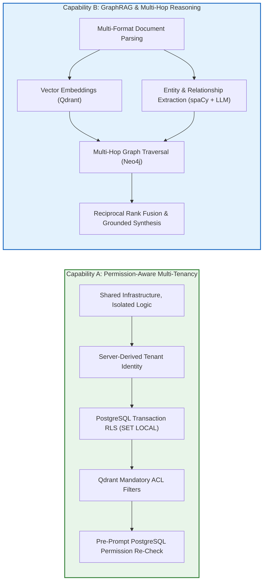
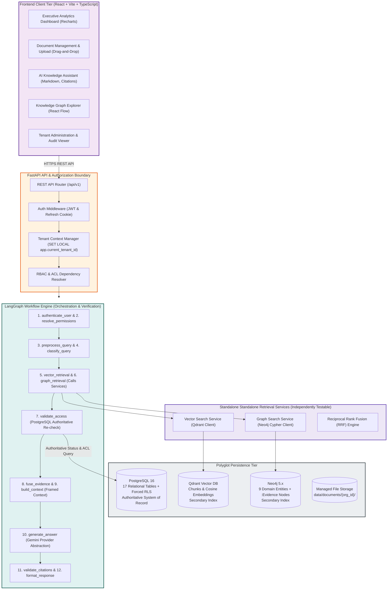
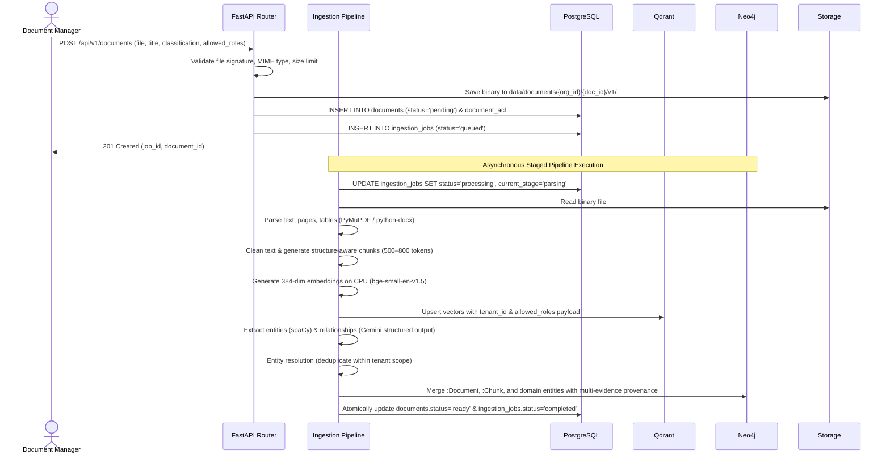
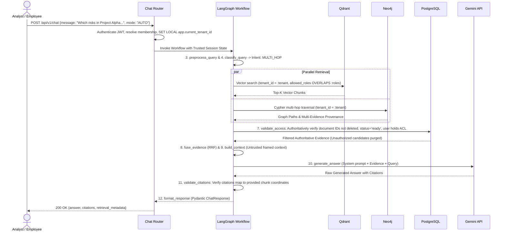

# System Architecture Specification

> **Enterprise Knowledge Intelligence Platform — Phase 0 Architecture Document**
> Comprehensive Technical Architecture, Component Specifications, Data Flows, and Architecture Decision Records (ADRs)

---

## Table of Contents

1. [Executive Summary & Problem Statement](#1-executive-summary--problem-statement)
2. [Primary Architectural Differentiators](#2-primary-architectural-differentiators)
3. [High-Level System Architecture](#3-high-level-system-architecture)
4. [Component Architecture & Division of Responsibilities](#4-component-architecture--division-of-responsibilities)
5. [End-to-End Data Flows & Sequence Diagrams](#5-end-to-end-data-flows--sequence-diagrams)
6. [Multi-Tenant Isolation Architecture](#6-multi-tenant-isolation-architecture)
7. [Technology Stack & Justification](#7-technology-stack--justification)
8. [Hardware Constraints & Staged Deployment Model](#8-hardware-constraints--staged-deployment-model)
9. [Failure Handling, Fallback Modes, and Resilience](#9-failure-handling-fallback-modes-and-resilience)
10. [Architecture Decision Records (ADRs)](#10-architecture-decision-records-adrs)
11. [System Limitations & Future Enhancements](#11-system-limitations--future-enhancements)

---

## 1. Executive Summary & Problem Statement

### 1.1 The Enterprise Problem
Modern enterprises accumulate massive corpuses of internal unstructured and semi-structured documentation: quarterly financial reports, corporate compliance audits, project risk assessments, technical engineering specifications, operational manuals, and HR policies. Employees and decision-makers struggle to extract actionable intelligence across these siloed documents.

Traditional search mechanisms fail in two major ways:
1. **Keyword Search (Lexical):** Matches exact terminology but fails on synonymy, semantic meaning, cross-document context, and conceptual synthesis.
2. **Standard Vector RAG (Semantic Search):**
   - Retrieves top-K semantically similar chunks based on cosine similarity.
   - **Struggles with multi-hop questions** where answering a query requires traversing relationships across multiple distinct documents (e.g., connecting a financial risk in Project Alpha to an approved mitigation strategy signed by an executive in a separate memo).
   - **Lacks granular, multi-tenant permission awareness**, risking cross-tenant data leakage or internal confidentiality breaches when documents have differing clearance levels.
   - **Suffers from hallucination and unsupported claims** when chunks lack explicit relationship context.

### 1.2 The Proposed Solution
The **Enterprise Knowledge Intelligence Platform** is a multi-tenant corporate intelligence system that combines:
- **Permission-Aware Multi-Tenant RAG:** Strict cryptographic and logical isolation ensuring users retrieve only data they are authorized to access across tenant boundaries, organizational roles, and document-level ACLs.
- **Graph Retrieval-Augmented Generation (GraphRAG):** Entity extraction, relationship mapping, and multi-hop graph traversal in Neo4j coupled with dense vector retrieval in Qdrant, orchestrated via LangGraph.
- **Strict Evidence Grounding & Citation Validation:** Guaranteed traceability linking every generated claim to authoritative source documents, page numbers, and chunk coordinates.

---

## 2. Primary Architectural Differentiators

The application focuses rigorously on two core differentiators:

### Capability A: Permission-Aware Multi-Tenant RAG
1. **Zero Client Trust:** Tenant context (`organization_id`), user ID, and active roles are resolved strictly from authenticated server records.
2. **Multi-Layer Defense:** Enforced at API gateways, relational database RLS, vector payload queries, and graph Cypher patterns.
3. **Immediate Revocation:** If an administrator revokes a user's ACL permission or soft-deletes a document, subsequent queries immediately exclude that document—even before vector or graph background synchronization occurs.

### Capability B: GraphRAG with Multi-Hop Reasoning
1. **Relational Entity Modeling:** Transforms unstructured documents into interconnected knowledge graphs representing people, departments, projects, risks, strategies, and products.
2. **Cross-Document Synthesis:** Follows paths across documents: `(Project Alpha) -> [:HAS_RISK] -> (Liquidity Risk) -> [:ADDRESSED_BY] -> (Mitigation Strategy) -> [:APPROVED_BY] -> (CFO)`.
3. **Explicit Multi-Evidence Provenance Model:** Every relationship is supported by first-class `:Evidence` nodes in Neo4j (`(a)-[:HAS_EVIDENCE]->(e:Evidence)-[:EVIDENCE_FOR]->(b)`), recording `source_document_id`, `source_chunk_id`, page number, confidence, and timestamp. Direct semantic edges retain `evidence_count` for rapid traversal, and deleting one document deletes only its evidence nodes while preserving shared domain entities (including `:Concept`) and relationships supported by other active documents.

---

## 3. High-Level System Architecture

The platform is designed as a **modular monolith** with clear component boundaries, staged infrastructure, and polyglot persistence.

---

## 4. Component Architecture & Division of Responsibilities

### 4.1 FastAPI Backend Layer
- **Responsibilities:**
  - Handles HTTP ingress, route dispatching, request/response serialization via Pydantic v2.
  - Authenticates JWT signatures, validates token expiration and active user status.
  - Validates active membership in the selected organization (`X-Organization-ID` hint).
  - Establishes transaction-scoped PostgreSQL tenant context via `SET LOCAL app.current_tenant_id = :tenant_id`.
  - Verifies RBAC permissions via FastAPI dependencies before delegating to service layers.
- **Security Boundary:** FastAPI is the authoritative ingress gateway establishing trusted user context.

### 4.2 Standalone Retrieval Services
To avoid tight coupling and ensure independent unit/integration testability:
- `vector_search.py`: Standalone service wrapping the Qdrant client with mandatory tenant and ACL filters.
- `graph_search.py`: Standalone service executing parameterized Cypher templates with tenant constraints.
- `reranker.py`: Standalone service executing Reciprocal Rank Fusion (RRF) scoring.
- These services are directly testable via Pytest without requiring a LangGraph execution context.

### 4.3 LangGraph Orchestration Engine
- **Responsibilities:**
  - Receives trusted request context (user_id, tenant_id, roles, permissions) from FastAPI.
  - Executes state machine transitions over typed `RAGState`.
  - Classifies query intent and conditionally invokes retrieval services.
  - **`validate_access` Node:** Authoritatively queries PostgreSQL to revalidate all candidate evidence IDs against live document ACLs and deletion status.
  - Assembles prompt with untrusted data framing.
  - Invokes Gemini API through a provider abstraction and validates citation coordinates.

### 4.4 Persistence Systems Division of Authority
1. **PostgreSQL 16 (Authoritative Authority):**
   - Sole authority for user accounts, memberships, roles, permissions, document metadata, document status (`pending`/`processing`/`ready`/`deleted`), document ACLs, chat history, and audit logs.
   - Enforces transaction-scoped Row-Level Security (`SET LOCAL`) on all 9 tenant-owned tables.
2. **Qdrant Vector DB (Secondary Retrieval Index):**
   - High-speed vector index for 384-dimensional chunk embeddings.
   - Pre-filters by tenant and permitted roles/users as a retrieval optimization.
3. **Neo4j 5.x (Secondary Graph Index):**
   - Graph index modeling 9 domain entities (`Organization`, `Person`, `Department`, `Project`, `Risk`, `Strategy`, `Event`, `Product`, `Concept`) and multi-hop relationships.
   - Explicit `:Evidence` node provenance pattern enables multi-evidence support and safe independent document lifecycles.
4. **Managed Storage:** Local filesystem storage organized by `data/documents/{org_id}/{doc_id}/v{version}/`.

---

## 5. End-to-End Data Flows & Sequence Diagrams

### 5.1 Staged Document Ingestion Flow

Cross-database ingestion is executed as a staged, idempotent workflow rather than a single distributed transaction:

### 5.2 Hybrid Query Processing Flow

---

## 6. Multi-Tenant Isolation Architecture

The platform implements a **shared database, shared schema** architecture. Isolation is guaranteed through five independent boundaries:

| Layer | Mechanism | Bypass Prevention |
|---|---|---|
| **1. Application Ingress** | FastAPI dependencies derive tenant ID strictly from authenticated session token and verified active membership. | `organization_id` supplied in request bodies or query params is ignored or validated against active memberships. |
| **2. PostgreSQL RLS & Schema** | Row-Level Security enabled and FORCED on all 9 tenant-owned tables (`documents`, `document_versions`, `document_acl`, `conversations`, `messages`, `feedback`, `ingestion_jobs`, `document_cleanup_tasks`, `audit_logs`). Tenant management tables (`organizations`, `memberships`, `user_roles`) scoped via explicit query logic. Global tables read-only; `refresh_tokens` user-scoped. | Session context set via `SET LOCAL app.current_tenant_id = :tenant_id` inside each transaction. Dedicated app DB role lacks `BYPASSRLS`. |
| **3. Vector Store (Qdrant)** | Mandatory payload filter combining `tenant_id == current_tenant` with `min_should: 1` over authorization conditions (`is_public_within_tenant`, `allowed_roles`, `allowed_users`). | Client cannot inject arbitrary filter strings; filters are structured Python objects. PostgreSQL remains authoritative for final validation. |
| **4. Graph Store (Neo4j)** | All Cypher queries constrain every node, evidence record, and relationship along traversal paths: `{tenant_id: $tenant_id}`. | LLM is never permitted to execute freeform Cypher. Hardcoded, parameterized Cypher templates only. |
| **5. Pre-Prompt Re-Check** | `validate_access` node in LangGraph cross-checks every candidate chunk against live PostgreSQL document records. | Even if vector or graph stores contain stale metadata, unauthorized chunks are discarded before context assembly. |

---

## 7. Technology Stack & Justification

| Layer | Technology | Version | Architectural Justification |
|---|---|---|---|
| **Frontend Framework** | React + Vite | 18.x / 5.x | Standalone SPA, high developer velocity, fast HMR, standard enterprise web client. |
| **Language (Frontend)** | TypeScript | 5.x | Static typing for API contracts, Pydantic model alignment, robust refactoring. |
| **Styling** | Tailwind CSS | 3.4.x | Utility-first CSS, consistent design system, zero runtime overhead. |
| **Graph UI** | React Flow | 11.x | Specialized node-based interactive graph rendering for knowledge exploration. |
| **Charts** | Recharts | 2.x | Declarative React charting for executive analytics dashboard. |
| **Backend Framework** | FastAPI | 0.111.x | Async native, automatic OpenAPI/Swagger generation, Pydantic v2 validation. |
| **Language (Backend)** | Python | 3.12 | Modern runtime, advanced typing support, ecosystem standard for AI/ML engineering. |
| **Relational Database** | PostgreSQL | 16 | ACID transactions, robust Row-Level Security, JSONB indexing, relational integrity. |
| **ORM & Migrations** | SQLAlchemy / Alembic | 2.0.x / 1.13.x | Async relational mapping, declarative models, schema migration versioning. |
| **Vector Database** | Qdrant | 1.9.x | High-performance Rust vector engine, payload filtering, tenant-scoped indexing. |
| **Graph Database** | Neo4j Community | 5.x | Native property graph, Cypher query language, multi-hop relationship traversal. |
| **Orchestration** | LangGraph | 0.0.x | Stateful multi-actor workflow engine, cyclic graph support, conditional routing. |
| **Embeddings** | BAAI/bge-small-en-v1.5 | 384 dim | SOTA retrieval performance for size (~130 MB), highly optimized for CPU execution. |
| **NLP & Entity Ext.** | spaCy | 3.7.x (`en_core_web_sm`) | Fast, local CPU-bound named entity recognition for core linguistic entities. |
| **LLM Provider** | Google Gemini API | 2.0 Flash / Pro | Fast inference, structured JSON output, long context window, hosted API. |

---

## 8. Hardware Constraints & Staged Deployment Model

### 8.1 Machine Profile & Memory Budget
- **CPU:** Intel Core Ultra 7 255H (16 cores / 22 threads)
- **RAM:** 16 GB LPDDR5
- **GPU:** Intel Arc Integrated Graphics (no dedicated CUDA / NVIDIA GPU)
- **Storage:** ~320 GB available SSD space
- **OS:** Windows 11 with WSL2 / Docker Desktop

| Service | Execution Mode | Memory Limit | Allocation Notes |
|---|---|---|---|
| **PostgreSQL 16** | Docker Container | 512 MB – 1 GB | Configured via `deploy.resources.limits.memory` |
| **Qdrant Vector DB** | Docker Container | 512 MB – 1 GB | Memory-mapped storage, low footprint for ~30 docs |
| **Neo4j Graph DB** | Docker Container | 1.0 GB – 1.5 GB | Heap max `512m`, pagecache `256m` via env vars |
| **FastAPI Backend + Embeddings** | Host Python Process | 1.0 GB – 1.5 GB | BGE-small uses ~300 MB; spaCy uses ~50 MB |
| **React Dev Server (Vite)** | Host Node.js Process | 200 MB – 300 MB | Fast lightweight development server |
| **Windows OS + System** | Host OS | 8.0 GB – 10.0 GB | Baseline OS, IDE, and background tasks |
| **Total Peak Usage** | — | **~12.5 GB / 16 GB** | Safe headroom (~3.5 GB free) |

### 8.2 Staged Infrastructure Sequence
1. **Phase 1 (Foundation):** Start PostgreSQL container only.
2. **Phase 4 (Vector RAG):** Start Qdrant container alongside PostgreSQL.
3. **Phase 5 (Graph Construction):** Start Neo4j container alongside PostgreSQL and Qdrant.
4. **Phase 6+ (Full Hybrid):** Run all three databases during integrated testing.
5. **Redis:** Optional (Phase 10+); introduced only if background job queuing via Celery is justified.

---

## 9. Failure Handling, Fallback Modes, and Resilience

| Failure Scenario | Immediate System Response | User Impact & Notification |
|---|---|---|
| **Neo4j Unavailable** | LangGraph catches connection timeout; falls back gracefully to vector-only retrieval in `vector_retrieval` node. | Answer generated with disclosure in response metadata: `fallback_applied: true`. Explains graph service is temporarily offline. |
| **Qdrant Unavailable** | LangGraph attempts graph traversal. If graph evidence is insufficient, halts safely without hallucinating. | Answer status set to `INSUFFICIENT_EVIDENCE`; reports vector index unavailable. |
| **PostgreSQL Unavailable** | System fails closed immediately. Returns `503 Service Unavailable`. | Requests rejected at auth/tenant middleware; zero unauthenticated queries allowed. |
| **Gemini API Rate Limit (429)** | Exponential backoff retry with jitter (3 attempts: 1s, 2s, 4s). | If retries exhausted, returns `504 Gateway Timeout` with message to retry shortly. |
| **Embedding Generation Error** | Ingestion job marks stage as `failed` with error details; does not proceed to Qdrant upsert. | Ingestion job status shows `failed`; user can click 'Retry Ingestion' in UI. |
| **Corrupt / Malformed PDF** | PyMuPDF raises parsing exception; caught by validation gauntlet. | Job marked `failed` with descriptive validation error: *"File corrupted or unreadable."* |

---

## 10. Architecture Decision Records (ADRs)

### ADR-001: Modular Monolith vs. Microservices
- **Decision:** Build as a single modular monolithic backend in FastAPI rather than distributed microservices.
- **Rationale:** Reduces network latency, simplifies transaction management, avoids distributed tracing overhead, fits local 16 GB RAM development budget, and facilitates straightforward database consistency across PostgreSQL, Qdrant, and Neo4j.

### ADR-002: Polyglot Persistence (PostgreSQL + Qdrant + Neo4j)
- **Decision:** Use three specialized database engines rather than forcing PostgreSQL extensions (`pgvector`, `Apache AGE`) to handle all workloads.
- **Rationale:**
  - PostgreSQL provides gold-standard ACID relational integrity, RLS, and transactional auditing.
  - Qdrant provides optimized, high-throughput HNSW vector indexing with payload filtering.
  - Neo4j provides native graph index-free adjacency for multi-hop relationship traversals that become prohibitively slow in relational recursive CTEs.

### ADR-003: LangGraph for Workflow Orchestration
- **Decision:** Orchestrate RAG queries using LangGraph rather than linear sequential chains.
- **Rationale:** LangGraph provides an explicit, typed state machine supporting conditional branching (Vector vs. Graph vs. Hybrid), bounded retry loops, post-retrieval validation checkpoints, and fallback modes.

### ADR-004: Hybrid RAG (Vector + Graph) with Reciprocal Rank Fusion
- **Decision:** Combine vector chunks and graph paths using Reciprocal Rank Fusion (RRF).
- **Rationale:** Vector search excels at finding unstructured semantic passages; knowledge graphs excel at multi-hop relationship connectivity. Combining both captures both explicit facts and relational context.

### ADR-005: Shared Database / Shared Schema with Forced RLS
- **Decision:** Partition multi-tenant data using `organization_id` columns with forced PostgreSQL RLS rather than schema-per-tenant or database-per-tenant.
- **Rationale:** Dramatically simplifies database migrations (a single Alembic migration applies to all tenants), minimizes memory consumption on local hardware, and provides ironclad defense-in-depth via `SET LOCAL app.current_tenant_id`.

### ADR-006: Short-Lived JWT + Stateful Refresh Tokens with Single-Flight Mutex & Family Tracking
- **Decision:** Issue 15-minute stateless JWTs and 7-day stateful refresh tokens with client-side single-flight promise latching, backend transaction-level row locking (`SELECT ... FOR UPDATE`), and immediate token-family reuse detection.
- **Rationale:** Combines performance of stateless API authorization with instantaneous session revocation capabilities. Refresh tokens stored strictly as SHA-256 hashes prevent token disclosure from database dumps. Frontend single-flight mutex prevents race conditions across concurrent browser requests, backend row locking serializes rotation, and immediate family revocation eliminates reliance on unsafe grace windows.

### ADR-007: Local CPU Embeddings + Hosted Cloud LLM
- **Decision:** Run BAAI/bge-small-en-v1.5 locally on CPU and use Google Gemini API for LLM generation.
- **Rationale:** The development machine has no NVIDIA GPU, making local 7B+ LLM inference unfeasible for multi-turn GraphRAG. BGE-small runs efficiently on CPU (~20ms per chunk), while Gemini API provides high-speed structured generation with zero GPU memory overhead.

---

## 11. System Limitations & Future Enhancements

### Current System Boundaries (Phase 0 Scope)
1. **CPU Embedding Throughput:** Chunk embeddings run synchronously in batches on CPU; batch ingestion of hundreds of documents will be rate-limited by CPU cores.
2. **Scanned PDF OCR:** Phase 0–3 focuses on programmatic digital PDFs (PyMuPDF). Scanned raster PDFs without embedded text layers require an OCR engine (Tesseract), planned as a Phase 3 extension.
3. **Graph Construction Latency:** Relationship extraction uses structured LLM calls; processing documents with many chunks requires rate-limit management on the Gemini API.

### Planned Post-Phase 0 Enhancements
- **Redis & Celery Task Queue:** Transitioning background ingestion jobs to dedicated asynchronous worker processes.
- **Streaming Responses (SSE):** Streaming LLM tokens directly to the React chat interface via Server-Sent Events.
- **S3-Compatible Object Storage:** Seamlessly swapping local filesystem storage for AWS S3 / MinIO via the `StorageBackend` abstraction.
