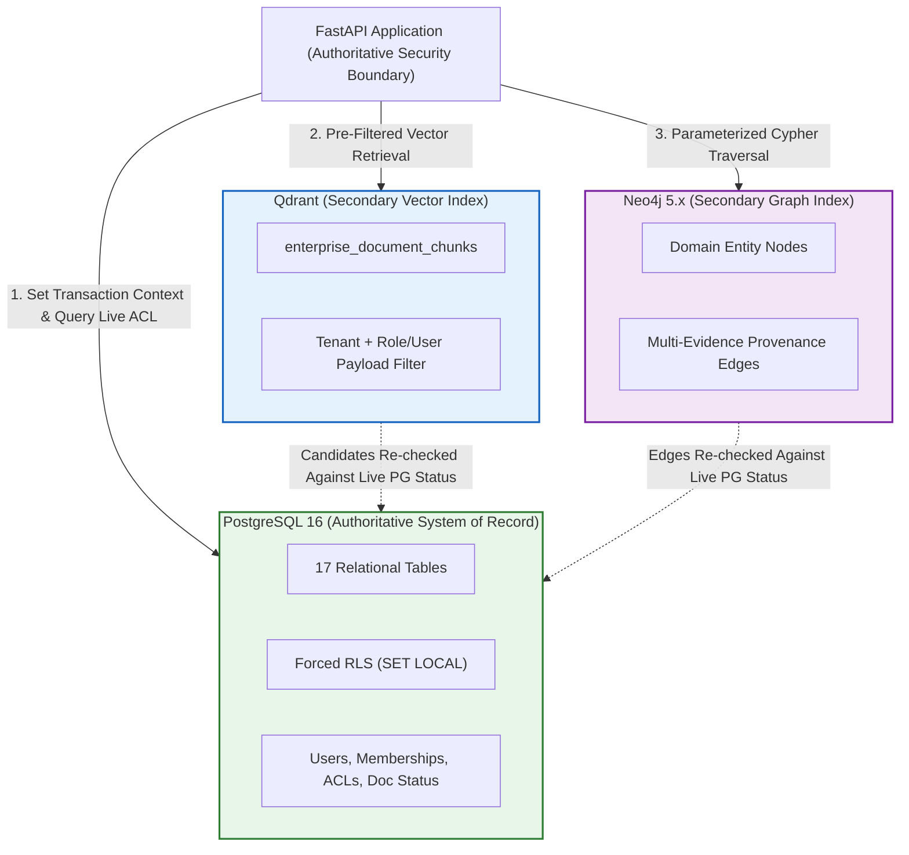
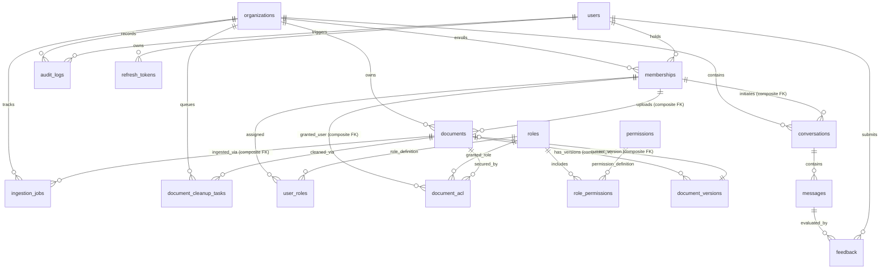
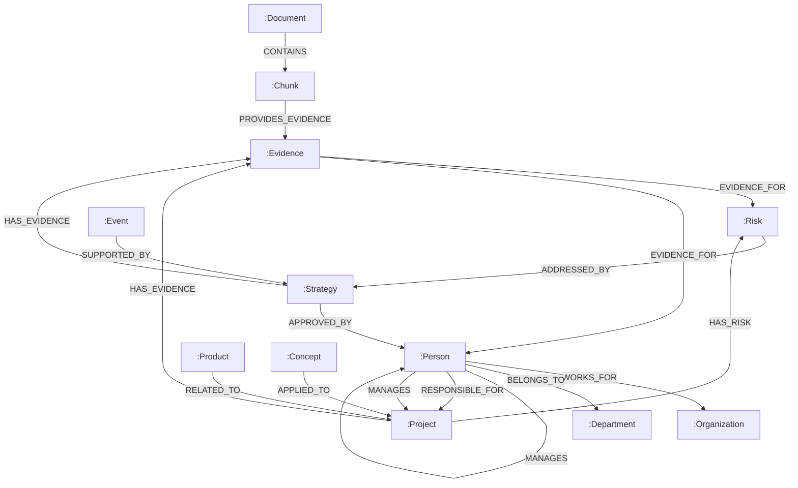
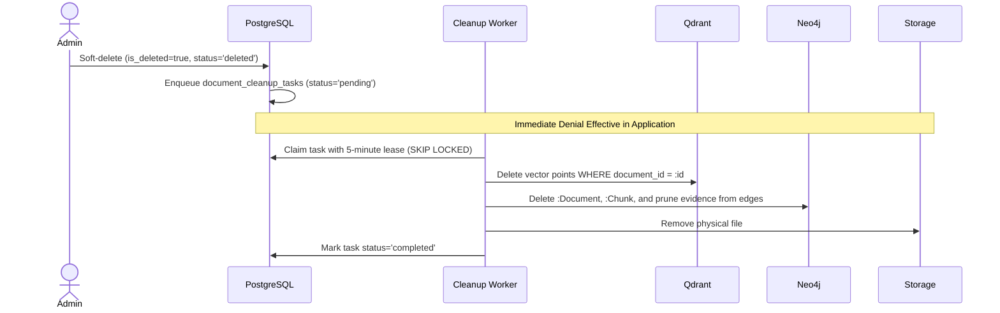
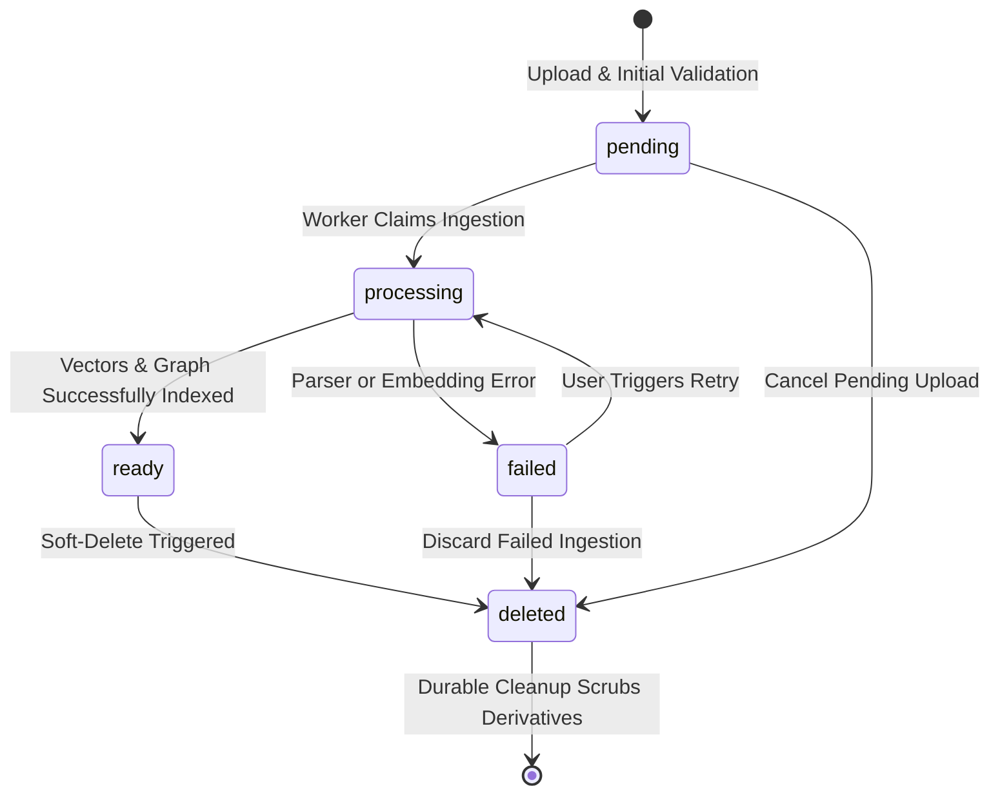

# Database Schema and Data Modeling Specification

> **Enterprise Knowledge Intelligence Platform — Phase 0 Database Reference**
> Comprehensive Technical Specifications for PostgreSQL 16 (17 Relational Tables), Qdrant Vector Store, Neo4j Knowledge Graph, and Multi-Database Consistency

---

## Table of Contents

1. [Database Strategy & Polyglot Architecture](#1-database-strategy--polyglot-architecture)
2. [PostgreSQL Relational Schema (17 Tables)](#2-postgresql-relational-schema-17-tables)
   - [2.1 Comprehensive Entity-Relationship Diagram](#21-comprehensive-entity-relationship-diagram)
   - [2.2 Detailed Table Specifications & Composite Tenant Constraints](#22-detailed-table-specifications--composite-tenant-constraints)
   - [2.3 RLS Coverage Matrix & Connection-Pool Safety](#23-rls-coverage-matrix--connection-pool-safety)
   - [2.4 Durable Document Cleanup Queue Specification](#24-durable-document-cleanup-queue-specification)
   - [2.5 Application-Managed Append-Only Audit Trail](#25-application-managed-append-only-audit-trail)
   - [2.6 Indexing & Query Optimization Strategy](#26-indexing--query-optimization-strategy)
   - [2.7 Alembic Migration & System Seeding](#27-alembic-migration--system-seeding)
3. [Qdrant Vector Database Schema](#3-qdrant-vector-database-schema)
   - [3.1 Collection Configuration](#31-collection-configuration)
   - [3.2 Payload Schema & Authorization Fields](#32-payload-schema--authorization-fields)
   - [3.3 Payload Indexing Strategy](#33-payload-indexing-strategy)
   - [3.4 Mandatory Server-Side Query Filters](#34-mandatory-server-side-query-filters)
4. [Neo4j Knowledge Graph Schema](#4-neo4j-knowledge-graph-schema)
   - [4.1 Graph Data Model Diagram](#41-graph-data-model-diagram)
   - [4.2 Node Label Definitions (12 Labels: 9 Domain + 3 Structural)](#42-node-label-definitions-12-labels-9-domain--3-structural)
   - [4.3 Relationship Types & Explicit Evidence Node Provenance Model](#43-relationship-types--explicit-evidence-node-provenance-model)
   - [4.4 Graph Constraints & Performance Indexes](#44-graph-constraints--performance-indexes)
   - [4.5 Parameterized Tenant-Constrained Cypher Templates](#45-parameterized-tenant-constrained-cypher-templates)
   - [4.6 Entity Preservation Rules on Document Deletion](#46-entity-preservation-rules-on-document-deletion)
5. [Cross-Database Consistency & Data Lifecycle](#5-cross-database-consistency--data-lifecycle)
   - [5.1 Staged Ingestion Write Order & Idempotency](#51-staged-ingestion-write-order--idempotency)
   - [5.2 Durable Deletion Cascade Workflow](#52-durable-deletion-cascade-workflow)
   - [5.3 Document State Machine Diagram](#53-document-state-machine-diagram)
6. [Storage & Resource Sizing Estimates](#6-storage--resource-sizing-estimates)

---

## 1. Database Strategy & Polyglot Architecture

The platform handles three distinct storage paradigms:
1. **Relational & Authoritative Data (PostgreSQL 16):** The **sole authoritative source of truth** for tenant identity, authentication, memberships, RBAC roles, document metadata, versioning, fine-grained ACLs, chat sessions, feedback, and audit logs.
2. **Dense Vector Embeddings (Qdrant):** 384-dimensional chunk embeddings indexed with HNSW for approximate nearest neighbor (ANN) search, pre-filtered with tenant and ACL payload tags.
3. **Property Graph & Provenance (Neo4j Community 5.x):** Business entities and multi-hop relationships with a multi-evidence provenance model, queried via parameterized Cypher constrained by tenant ID.



---

## 2. PostgreSQL Relational Schema (17 Tables)

### 2.1 Comprehensive Entity-Relationship Diagram



---

### 2.2 Detailed Table Specifications & Composite Tenant Constraints

#### 1. `organizations` (Tenant Registry)
```sql
CREATE TABLE organizations (
    id UUID PRIMARY KEY DEFAULT gen_random_uuid(),
    name VARCHAR(255) NOT NULL,
    slug VARCHAR(255) NOT NULL UNIQUE,
    description TEXT,
    is_active BOOLEAN NOT NULL DEFAULT true,
    created_at TIMESTAMP WITH TIME ZONE NOT NULL DEFAULT now(),
    updated_at TIMESTAMP WITH TIME ZONE NOT NULL DEFAULT now()
);
CREATE INDEX idx_organizations_slug ON organizations (slug);
```

#### 2. `users` (Global Identity Registry)
```sql
CREATE TABLE users (
    id UUID PRIMARY KEY DEFAULT gen_random_uuid(),
    email VARCHAR(255) NOT NULL UNIQUE,
    password_hash VARCHAR(255) NOT NULL,
    full_name VARCHAR(255) NOT NULL,
    is_active BOOLEAN NOT NULL DEFAULT true,
    is_superadmin BOOLEAN NOT NULL DEFAULT false,
    created_at TIMESTAMP WITH TIME ZONE NOT NULL DEFAULT now(),
    updated_at TIMESTAMP WITH TIME ZONE NOT NULL DEFAULT now()
);
CREATE INDEX idx_users_email ON users (email);
```

#### 3. `memberships` (Tenant Enrollment)
```sql
CREATE TABLE memberships (
    id UUID PRIMARY KEY DEFAULT gen_random_uuid(),
    user_id UUID NOT NULL REFERENCES users(id) ON DELETE CASCADE,
    organization_id UUID NOT NULL REFERENCES organizations(id) ON DELETE CASCADE,
    is_active BOOLEAN NOT NULL DEFAULT true,
    joined_at TIMESTAMP WITH TIME ZONE NOT NULL DEFAULT now(),
    CONSTRAINT uq_membership_user_org UNIQUE (user_id, organization_id),
    CONSTRAINT uq_membership_composite UNIQUE (organization_id, user_id)
);
CREATE INDEX idx_memberships_user ON memberships (user_id);
CREATE INDEX idx_memberships_org ON memberships (organization_id);
```

#### 4. `roles` (System Role Catalogue)
```sql
CREATE TABLE roles (
    id UUID PRIMARY KEY DEFAULT gen_random_uuid(),
    name VARCHAR(50) NOT NULL UNIQUE,
    display_name VARCHAR(100) NOT NULL,
    description TEXT,
    is_system BOOLEAN NOT NULL DEFAULT true
);
```

#### 5. `permissions` (Atomic Capabilities)
```sql
CREATE TABLE permissions (
    id UUID PRIMARY KEY DEFAULT gen_random_uuid(),
    name VARCHAR(100) NOT NULL UNIQUE,
    resource VARCHAR(50) NOT NULL,
    action VARCHAR(50) NOT NULL,
    description TEXT
);
```

#### 6. `role_permissions` (Role Capability Matrix)
```sql
CREATE TABLE role_permissions (
    id UUID PRIMARY KEY DEFAULT gen_random_uuid(),
    role_id UUID NOT NULL REFERENCES roles(id) ON DELETE CASCADE,
    permission_id UUID NOT NULL REFERENCES permissions(id) ON DELETE CASCADE,
    CONSTRAINT uq_role_permission UNIQUE (role_id, permission_id)
);
```

#### 7. `user_roles` (Membership Role Assignments)
```sql
CREATE TABLE user_roles (
    id UUID PRIMARY KEY DEFAULT gen_random_uuid(),
    membership_id UUID NOT NULL REFERENCES memberships(id) ON DELETE CASCADE,
    role_id UUID NOT NULL REFERENCES roles(id) ON DELETE CASCADE,
    assigned_at TIMESTAMP WITH TIME ZONE NOT NULL DEFAULT now(),
    assigned_by UUID REFERENCES users(id) ON DELETE SET NULL,
    CONSTRAINT uq_user_membership_role UNIQUE (membership_id, role_id)
);
CREATE INDEX idx_user_roles_membership ON user_roles (membership_id);
```

#### 8. `refresh_tokens` (Stateful Refresh Sessions)
```sql
CREATE TABLE refresh_tokens (
    id UUID PRIMARY KEY DEFAULT gen_random_uuid(),
    user_id UUID NOT NULL REFERENCES users(id) ON DELETE CASCADE,
    token_hash VARCHAR(64) NOT NULL UNIQUE,
    family_id UUID NOT NULL,
    is_revoked BOOLEAN NOT NULL DEFAULT false,
    revoked_at TIMESTAMP WITH TIME ZONE,
    replaced_by_token_hash VARCHAR(64),
    expires_at TIMESTAMP WITH TIME ZONE NOT NULL,
    last_used_at TIMESTAMP WITH TIME ZONE,
    created_at TIMESTAMP WITH TIME ZONE NOT NULL DEFAULT now()
);
CREATE INDEX idx_refresh_tokens_hash ON refresh_tokens (token_hash);
CREATE INDEX idx_refresh_tokens_family ON refresh_tokens (family_id);
CREATE INDEX idx_refresh_tokens_user ON refresh_tokens (user_id);
```

#### 9. `documents` (Core Document Registry)
```sql
CREATE TABLE documents (
    id UUID PRIMARY KEY DEFAULT gen_random_uuid(),
    organization_id UUID NOT NULL REFERENCES organizations(id) ON DELETE CASCADE,
    uploaded_by UUID NOT NULL,
    title VARCHAR(500) NOT NULL,
    filename VARCHAR(255) NOT NULL,
    mime_type VARCHAR(100) NOT NULL,
    file_size BIGINT NOT NULL,
    file_hash VARCHAR(64) NOT NULL,
    storage_path VARCHAR(1000) NOT NULL,
    department VARCHAR(100),
    classification VARCHAR(50) NOT NULL DEFAULT 'internal',
    tags JSONB NOT NULL DEFAULT '[]'::jsonb,
    status VARCHAR(50) NOT NULL DEFAULT 'pending',
    current_version_id UUID,
    is_deleted BOOLEAN NOT NULL DEFAULT false,
    deleted_at TIMESTAMP WITH TIME ZONE,
    created_at TIMESTAMP WITH TIME ZONE NOT NULL DEFAULT now(),
    updated_at TIMESTAMP WITH TIME ZONE NOT NULL DEFAULT now(),
    CONSTRAINT uq_document_composite UNIQUE (id, organization_id),
    -- Composite tenant foreign key: uploader MUST be an active member of the document's organization
    CONSTRAINT fk_document_uploader_membership FOREIGN KEY (organization_id, uploaded_by)
        REFERENCES memberships(organization_id, user_id) ON DELETE RESTRICT
);
CREATE INDEX idx_documents_org_status ON documents (organization_id, status) WHERE is_deleted = false;
CREATE INDEX idx_documents_file_hash ON documents (organization_id, file_hash) WHERE is_deleted = false;
CREATE INDEX idx_documents_tags ON documents USING GIN (tags);
```

#### 10. `document_versions` (Document Revision History)
```sql
CREATE TABLE document_versions (
    id UUID PRIMARY KEY DEFAULT gen_random_uuid(),
    document_id UUID NOT NULL,
    organization_id UUID NOT NULL,
    version_number INT NOT NULL,
    file_hash VARCHAR(64) NOT NULL,
    storage_path VARCHAR(1000) NOT NULL,
    file_size BIGINT NOT NULL,
    created_by UUID NOT NULL,
    created_at TIMESTAMP WITH TIME ZONE NOT NULL DEFAULT now(),
    CONSTRAINT uq_doc_version_number UNIQUE (document_id, version_number),
    CONSTRAINT uq_doc_version_composite UNIQUE (document_id, id),
    -- Enforce version belongs to parent document and parent tenant
    CONSTRAINT fk_version_parent_document FOREIGN KEY (document_id, organization_id)
        REFERENCES documents(id, organization_id) ON DELETE CASCADE,
    -- Enforce creator belongs to document organization
    CONSTRAINT fk_version_creator_membership FOREIGN KEY (organization_id, created_by)
        REFERENCES memberships(organization_id, user_id) ON DELETE RESTRICT
);
CREATE INDEX idx_doc_versions_doc ON document_versions (document_id);

-- Enforce documents.current_version_id references a version belonging strictly to that same document
ALTER TABLE documents
    ADD CONSTRAINT fk_document_current_version FOREIGN KEY (id, current_version_id)
    REFERENCES document_versions(document_id, id) ON DELETE SET NULL;
```

#### 11. `document_acl` (Granular Access Grants)
```sql
CREATE TABLE document_acl (
    id UUID PRIMARY KEY DEFAULT gen_random_uuid(),
    document_id UUID NOT NULL,
    organization_id UUID NOT NULL,
    grant_type VARCHAR(20) NOT NULL CHECK (grant_type IN ('role', 'user')),
    role_id UUID REFERENCES roles(id) ON DELETE CASCADE,
    user_id UUID,
    permission_level VARCHAR(20) NOT NULL CHECK (permission_level IN ('read', 'write', 'manage')),
    granted_by UUID NOT NULL,
    granted_at TIMESTAMP WITH TIME ZONE NOT NULL DEFAULT now(),
    -- Enforce parent document and tenant relationship
    CONSTRAINT fk_acl_parent_document FOREIGN KEY (document_id, organization_id)
        REFERENCES documents(id, organization_id) ON DELETE CASCADE,
    -- Target XOR check: exactly one target must be populated
    CONSTRAINT chk_acl_target_xor CHECK (
        (role_id IS NOT NULL AND user_id IS NULL AND grant_type = 'role') OR
        (role_id IS NULL AND user_id IS NOT NULL AND grant_type = 'user')
    ),
    -- Composite tenant foreign key: user grant target MUST belong to document organization
    CONSTRAINT fk_acl_target_user_membership FOREIGN KEY (organization_id, user_id)
        REFERENCES memberships(organization_id, user_id) ON DELETE CASCADE,
    -- Grantor MUST belong to document organization
    CONSTRAINT fk_acl_grantor_membership FOREIGN KEY (organization_id, granted_by)
        REFERENCES memberships(organization_id, user_id) ON DELETE RESTRICT
);
CREATE INDEX idx_document_acl_doc ON document_acl (document_id);
CREATE INDEX idx_document_acl_role ON document_acl (role_id) WHERE role_id IS NOT NULL;
CREATE INDEX idx_document_acl_user ON document_acl (user_id) WHERE user_id IS NOT NULL;
```

#### 12. `conversations` (Chat Session Headers)
```sql
CREATE TABLE conversations (
    id UUID PRIMARY KEY DEFAULT gen_random_uuid(),
    organization_id UUID NOT NULL REFERENCES organizations(id) ON DELETE CASCADE,
    user_id UUID NOT NULL,
    title VARCHAR(255) NOT NULL DEFAULT 'New Conversation',
    is_active BOOLEAN NOT NULL DEFAULT true,
    created_at TIMESTAMP WITH TIME ZONE NOT NULL DEFAULT now(),
    updated_at TIMESTAMP WITH TIME ZONE NOT NULL DEFAULT now(),
    -- Conversation creator must belong to conversation organization
    CONSTRAINT fk_conversation_user_membership FOREIGN KEY (organization_id, user_id)
        REFERENCES memberships(organization_id, user_id) ON DELETE CASCADE
);
CREATE INDEX idx_conversations_org_user ON conversations (organization_id, user_id);
```

#### 13. `messages` (Chat Turns with Citations)
```sql
CREATE TABLE messages (
    id UUID PRIMARY KEY DEFAULT gen_random_uuid(),
    conversation_id UUID NOT NULL REFERENCES conversations(id) ON DELETE CASCADE,
    organization_id UUID NOT NULL REFERENCES organizations(id) ON DELETE CASCADE,
    role VARCHAR(20) NOT NULL CHECK (role IN ('user', 'assistant', 'system')),
    content TEXT NOT NULL,
    retrieval_mode VARCHAR(20) CHECK (retrieval_mode IN ('AUTO', 'VECTOR', 'GRAPH', 'HYBRID')),
    citations JSONB DEFAULT '[]'::jsonb,
    metadata JSONB DEFAULT '{}'::jsonb,
    created_at TIMESTAMP WITH TIME ZONE NOT NULL DEFAULT now()
);
CREATE INDEX idx_messages_conversation ON messages (conversation_id, created_at);
```

#### 14. `feedback` (Response Evaluations)
```sql
CREATE TABLE feedback (
    id UUID PRIMARY KEY DEFAULT gen_random_uuid(),
    message_id UUID NOT NULL REFERENCES messages(id) ON DELETE CASCADE,
    organization_id UUID NOT NULL REFERENCES organizations(id) ON DELETE CASCADE,
    user_id UUID NOT NULL,
    rating VARCHAR(20) NOT NULL CHECK (rating IN ('positive', 'negative')),
    comment TEXT,
    created_at TIMESTAMP WITH TIME ZONE NOT NULL DEFAULT now(),
    CONSTRAINT uq_feedback_message_user UNIQUE (message_id, user_id),
    -- Feedback user must belong to conversation organization
    CONSTRAINT fk_feedback_user_membership FOREIGN KEY (organization_id, user_id)
        REFERENCES memberships(organization_id, user_id) ON DELETE CASCADE
);
CREATE INDEX idx_feedback_message ON feedback (message_id);
```

#### 15. `ingestion_jobs` (Ingestion Status Tracking)
```sql
CREATE TABLE ingestion_jobs (
    id UUID PRIMARY KEY DEFAULT gen_random_uuid(),
    document_id UUID NOT NULL,
    organization_id UUID NOT NULL,
    status VARCHAR(50) NOT NULL DEFAULT 'queued' CHECK (status IN ('queued', 'processing', 'completed', 'failed', 'retrying')),
    current_stage VARCHAR(50) NOT NULL DEFAULT 'queued',
    progress_pct INT NOT NULL DEFAULT 0,
    total_chunks INT NOT NULL DEFAULT 0,
    processed_chunks INT NOT NULL DEFAULT 0,
    error_message TEXT,
    retry_count INT NOT NULL DEFAULT 0,
    max_retries INT NOT NULL DEFAULT 3,
    started_at TIMESTAMP WITH TIME ZONE,
    completed_at TIMESTAMP WITH TIME ZONE,
    created_at TIMESTAMP WITH TIME ZONE NOT NULL DEFAULT now(),
    updated_at TIMESTAMP WITH TIME ZONE NOT NULL DEFAULT now(),
    CONSTRAINT fk_ingestion_parent_document FOREIGN KEY (document_id, organization_id)
        REFERENCES documents(id, organization_id) ON DELETE CASCADE
);
CREATE INDEX idx_ingestion_jobs_doc ON ingestion_jobs (document_id);
CREATE INDEX idx_ingestion_jobs_org_status ON ingestion_jobs (organization_id, status);
```

#### 16. `document_cleanup_tasks` (Durable Deletion Task Queue)
```sql
CREATE TABLE document_cleanup_tasks (
    id UUID PRIMARY KEY DEFAULT gen_random_uuid(),
    document_id UUID NOT NULL,
    organization_id UUID NOT NULL REFERENCES organizations(id) ON DELETE CASCADE,
    target_system VARCHAR(50) NOT NULL CHECK (target_system IN ('qdrant', 'neo4j', 'storage', 'all')),
    status VARCHAR(50) NOT NULL DEFAULT 'pending' CHECK (status IN ('pending', 'processing', 'completed', 'failed')),
    retry_count INT NOT NULL DEFAULT 0,
    max_retries INT NOT NULL DEFAULT 5,
    claimed_by VARCHAR(100),
    claimed_at TIMESTAMP WITH TIME ZONE,
    error_message TEXT,
    created_at TIMESTAMP WITH TIME ZONE NOT NULL DEFAULT now(),
    updated_at TIMESTAMP WITH TIME ZONE NOT NULL DEFAULT now(),
    -- Enforce task uniqueness per document and target system
    CONSTRAINT uq_cleanup_doc_target UNIQUE (document_id, target_system)
);
CREATE INDEX idx_cleanup_tasks_pending ON document_cleanup_tasks (status, claimed_at) WHERE status IN ('pending', 'failed');
```

#### 17. `audit_logs` (Application-Managed Append-Only Trail)
```sql
CREATE TABLE audit_logs (
    id UUID PRIMARY KEY DEFAULT gen_random_uuid(),
    organization_id UUID REFERENCES organizations(id) ON DELETE SET NULL,
    user_id UUID REFERENCES users(id) ON DELETE SET NULL,
    action VARCHAR(100) NOT NULL,
    resource_type VARCHAR(50) NOT NULL,
    resource_id UUID,
    details JSONB NOT NULL DEFAULT '{}'::jsonb,
    ip_address VARCHAR(45),
    created_at TIMESTAMP WITH TIME ZONE NOT NULL DEFAULT now()
);
CREATE INDEX idx_audit_logs_org_created ON audit_logs (organization_id, created_at DESC);
CREATE INDEX idx_audit_logs_action ON audit_logs (action);
```

---

### 2.3 RLS Coverage Matrix & Connection-Pool Safety

To eliminate connection-pool cross-tenant leakage in FastAPI (`asyncpg`):
- All database operations execute inside an explicit transaction where `SET LOCAL app.current_tenant_id = :tenant_id` is run.
- When the transaction ends, the context variable immediately lapses.
- The application role `ekip_app` does NOT hold `SUPERUSER` or `BYPASSRLS`.

#### Explicit Table Security Categorization & RLS Coverage Matrix

All 17 tables are partitioned into four distinct security categories based on tenancy and authorization models:

1. **Category 1: Tenant-Owned Tables with Forced RLS (9 Tables)**
   - RLS is permanently enabled with `FORCE ROW LEVEL SECURITY`.
   - Access is restricted strictly to rows matching the transaction's `app.current_tenant_id`.
   - Tables: `documents`, `document_versions`, `document_acl`, `conversations`, `messages`, `feedback`, `ingestion_jobs`, `document_cleanup_tasks`, `audit_logs`.
2. **Category 2: Tenant Management Tables with Explicit Application Query Scoping (3 Tables)**
   - Tables: `organizations`, `memberships`, `user_roles`.
   - Cannot use rigid tenant-only RLS because users must discover organizations they belong to, authenticate across multiple memberships, and switch active tenant context. Scoped explicitly via `organization_id` and `user_id` query constraints in the application layer.
3. **Category 3: Global Reference Tables (4 Tables)**
   - Tables: `users`, `roles`, `permissions`, `role_permissions`.
   - Global across the platform; read-only to tenant sessions. `users` queries are filtered by caller identity (`id` / `email`).
4. **Category 4: User Security Table (1 Table)**
   - Table: `refresh_tokens`.
   - User-scoped security table. Filtered strictly by authenticated `user_id` and SHA-256 hashed token lookup.

| Table Name | Security Category | Table Type | RLS Enabled & Forced | Isolation Policy Definition |
|---|---|---|:---:|---|
| `documents` | Category 1 | Tenant-Owned | **YES** | `organization_id = NULLIF(current_setting('app.current_tenant_id', true), '')::uuid` |
| `document_versions` | Category 1 | Tenant-Owned | **YES** | `organization_id = NULLIF(current_setting('app.current_tenant_id', true), '')::uuid` |
| `document_acl` | Category 1 | Tenant-Owned | **YES** | `organization_id = NULLIF(current_setting('app.current_tenant_id', true), '')::uuid` |
| `conversations` | Category 1 | Tenant-Owned | **YES** | `organization_id = NULLIF(current_setting('app.current_tenant_id', true), '')::uuid` |
| `messages` | Category 1 | Tenant-Owned | **YES** | `organization_id = NULLIF(current_setting('app.current_tenant_id', true), '')::uuid` |
| `feedback` | Category 1 | Tenant-Owned | **YES** | `organization_id = NULLIF(current_setting('app.current_tenant_id', true), '')::uuid` |
| `ingestion_jobs` | Category 1 | Tenant-Owned | **YES** | `organization_id = NULLIF(current_setting('app.current_tenant_id', true), '')::uuid` |
| `document_cleanup_tasks` | Category 1 | Tenant-Owned | **YES** | `organization_id = NULLIF(current_setting('app.current_tenant_id', true), '')::uuid` |
| `audit_logs` | Category 1 | Tenant-Owned | **YES** | `organization_id = NULLIF(current_setting('app.current_tenant_id', true), '')::uuid` |
| `memberships` | Category 2 | Tenant Management | NO | Filtered by authenticated `user_id` or `organization_id` in application queries |
| `user_roles` | Category 2 | Tenant Management | NO | Filtered via join to `memberships` |
| `organizations` | Category 2 | Tenant Registry | NO | Selected via authenticated user memberships |
| `users` | Category 3 | Global Reference | NO | Filtered by `id` / `email` |
| `roles` | Category 3 | Global Reference | NO | Global read-only role definitions |
| `permissions` | Category 3 | Global Reference | NO | Global read-only permission definitions |
| `role_permissions` | Category 3 | Global Reference | NO | Global read-only role capability matrix |
| `refresh_tokens` | Category 4 | User Security | NO | Scoped strictly by `user_id` and hashed token lookup |

---

### 2.4 Durable Document Cleanup Queue Specification

When a document is soft-deleted, durable background tasks guarantee at-least-once, idempotent cleanup of vectors in Qdrant, subgraphs in Neo4j, and files on disk.

- **Task Uniqueness:** `UNIQUE (document_id, target_system)` prevents duplicate queue entries.
- **Worker Claim & Lease Semantics:**
  ```sql
  -- Atomic claim with a 5-minute lease
  UPDATE document_cleanup_tasks
  SET status = 'processing',
      claimed_by = :worker_id,
      claimed_at = now(),
      retry_count = retry_count + 1
  WHERE id = (
      SELECT id FROM document_cleanup_tasks
      WHERE status IN ('pending', 'failed')
        AND (claimed_at IS NULL OR claimed_at < now() - INTERVAL '5 minutes')
        AND retry_count < max_retries
      ORDER BY created_at ASC
      FOR UPDATE SKIP LOCKED
      LIMIT 1
  )
  RETURNING id, document_id, organization_id, target_system;
  ```
- **Idempotent Cleanup Steps:**
  - *Qdrant Task:* `client.delete(collection_name, points_selector=Filter(document_id=...))` is inherently idempotent.
  - *Neo4j Task:* Removes `:Document` and `:Chunk` nodes, deletes `:Evidence` nodes where `source_document_id = :id` and `tenant_id = :tenant_id`. Prunes semantic edges whose `evidence_count` drops to 0. Shared domain entity nodes are preserved.
  - *Storage Task:* Removes file path; ignores missing file exceptions (`FileNotFoundError`).
- **Failure Handling:** Failed tasks update `status = 'failed'` and record `error_message`. They become re-claimable after the 5-minute lease expires, up to `max_retries = 5`.

---

### 2.5 Application-Managed Append-Only Audit Trail

`audit_logs` is an application-managed append-only table. It is NOT described as cryptographically tamper-evident, but is secured by database privilege boundaries:
```sql
-- Security grants for dedicated app user
REVOKE UPDATE, DELETE, TRUNCATE ON audit_logs FROM ekip_app;
GRANT INSERT, SELECT ON audit_logs TO ekip_app;
```

---

### 2.6 Indexing & Query Optimization Strategy
- **Partial Indexes:** Indexes on active documents (`WHERE is_deleted = false`) prevent index bloat from historical deleted documents.
- **Composite Tenant Indexes:** `(organization_id, status)` optimizes dashboard counts and document listings.
- **JSONB GIN Indexes:** `tags JSONB` indexed with GIN enables fast keyword containment search.

---

### 2.7 Alembic Migration & System Seeding
- **Migration 001:** Creates all 17 tables, composite foreign keys, unique constraints, and indexes.
- **Migration 002:** Enables and forces RLS on the 9 tenant-owned tables and applies isolation policies.
- **Seeding:** Seeds 5 system roles, atomic permissions, role permissions, and the 3 initial demo organizations (Finova Technologies, Nova Healthcare, Apex Financial).

---

## 3. Qdrant Vector Database Schema

### 3.1 Collection Configuration
- **Collection Name:** `enterprise_document_chunks`
- **Vector Dimensions:** 384 (matches `BAAI/bge-small-en-v1.5`)
- **Distance Metric:** Cosine

### 3.2 Payload Schema & Authorization Fields
```json
{
  "tenant_id": "22222222-0000-0000-0000-000000000001",
  "document_id": "33333333-0000-0000-0000-000000000001",
  "document_version_id": "version-uuid-001",
  "chunk_id": "chunk_004",
  "chunk_index": 4,
  "page_number": 4,
  "section": "Financial & Liquidity Vulnerabilities",
  "is_public_within_tenant": false,
  "allowed_roles": ["org_admin", "doc_manager", "analyst"],
  "allowed_users": [],
  "department": "Finance",
  "classification": "confidential",
  "content_hash": "a1b2c3d4e5f6...",
  "text": "Project Alpha faces liquidity risk stemming from overdue vendor receipts...",
  "document_title": "Project Alpha Risk Assessment",
  "created_at": "2026-11-06T12:00:00Z"
}
```

### 3.3 Payload Indexing Strategy
Mandatory payload schema indexes in Qdrant:
1. `tenant_id` (`keyword`)
2. `document_id` (`keyword`)
3. `is_public_within_tenant` (`bool`)
4. `allowed_roles` (`keyword`)
5. `allowed_users` (`keyword`)
6. `classification` (`keyword` — informational only)
7. `department` (`keyword`)
8. `chunk_index` (`integer`)
9. `page_number` (`integer`)

### 3.4 Mandatory Server-Side Query Filters
Every Qdrant search strictly enforces server-side filters. Classification is NEVER used to bypass ACL checks. Authorization conditions are mandatory; at least one grant condition must match alongside `tenant_id`:

```python
search_filter = models.Filter(
    must=[
        models.FieldCondition(key="tenant_id", match=models.MatchValue(value=str(session.organization_id))),
        models.Filter(
            min_should=models.MinShould(
                conditions=[
                    models.FieldCondition(key="is_public_within_tenant", match=models.MatchValue(value=True)),
                    models.FieldCondition(key="allowed_roles", match=models.MatchAny(any=user_roles)),
                    models.FieldCondition(key="allowed_users", match=models.MatchAny(any=[str(session.user_id)]))
                ],
                min_count=1
            )
        )
    ]
)
```

> [!IMPORTANT]
> **Pre-Retrieval Optimization vs. Authoritative Enforcement:**
> The Qdrant filter acts as an initial retrieval pre-filter to bound candidate chunks. PostgreSQL remains the sole authoritative source of truth for final document status (`is_deleted = false`, `status = 'ready'`) and ACL permission validation in the LangGraph `validate_access` node prior to synthesis.

---

## 4. Neo4j Knowledge Graph Schema

### 4.1 Graph Data Model Diagram



### 4.2 Node Label Definitions (12 Labels: 9 Domain + 3 Structural)
All nodes carry `id` (UUID), `tenant_id` (UUID), and specific domain properties:

#### Domain Entity Labels (9 Labels)
1. `:Organization {id, tenant_id, name}`
2. `:Person {id, tenant_id, name, title, department}`
3. `:Department {id, tenant_id, name}`
4. `:Project {id, tenant_id, name, status, budget}`
5. `:Risk {id, tenant_id, name, risk_type, severity}`
6. `:Strategy {id, tenant_id, name, strategy_type}`
7. `:Event {id, tenant_id, name, date}`
8. `:Product {id, tenant_id, name, category}`
9. `:Concept {id, tenant_id, name, description}` — generic business methodologies, domain concepts, or technical frameworks scoped strictly by tenant.

#### Structural and Provenance Labels (3 Labels)
10. `:Document {id, tenant_id, title, classification}`
11. `:Chunk {id, tenant_id, document_id, chunk_index, page_number}`
12. `:Evidence {id, tenant_id, source_document_id, source_chunk_id, page_number, section, confidence, extracted_at, relationship_type}` — first-class provenance node recording independent support for an entity connection.

### 4.3 Relationship Types & Explicit Evidence Node Provenance Model
Relationships are not supported by just a single document. Multiple documents can independently validate the same real-world connection. Rather than storing fragile JSON arrays on relationship edges, the platform uses an **explicit `:Evidence` node pattern**:

1. **Direct Semantic Relationship (Fast Traversal):**
   - `(a)-[:RELATION_NAME {tenant_id, created_at, evidence_count}]->(b)`
   - Provides performant multi-hop Cypher traversal without mandatory intermediate hops during structural queries.
2. **Explicit Evidence Linkage (Authoritative Provenance):**
   - `(a)-[:HAS_EVIDENCE]->(e:Evidence)-[:EVIDENCE_FOR]->(b)`
   - Connects the relationship to its specific source chunk: `(c:Chunk)-[:PROVIDES_EVIDENCE]->(e:Evidence)`
3. **Benefits of First-Class `:Evidence` Nodes:**
   - **No Write Concurrency Conflicts:** Multiple ingestion workers can link new evidence to existing entity pairs without read-modify-write race conditions on edge properties.
   - **Direct Indexing:** `Evidence.source_document_id` is indexed directly, enabling high-performance cascade deletions and live ACL verification.
   - **Strong Typing:** Confidence scores, page numbers, and timestamps are first-class typed properties.

**11 Direct Semantic Relationship Types:**
`WORKS_FOR`, `MANAGES`, `BELONGS_TO`, `HAS_RISK`, `ADDRESSED_BY`, `APPROVED_BY`, `MENTIONED_IN`, `CONTAINS`, `RESPONSIBLE_FOR`, `RELATED_TO`, `SUPPORTED_BY`.

### 4.4 Graph Constraints & Performance Indexes
```cypher
CREATE CONSTRAINT unique_document_id FOR (d:Document) REQUIRE d.id IS UNIQUE;
CREATE CONSTRAINT unique_chunk_id FOR (c:Chunk) REQUIRE c.id IS UNIQUE;
CREATE CONSTRAINT unique_evidence_id FOR (e:Evidence) REQUIRE e.id IS UNIQUE;

CREATE INDEX idx_person_tenant FOR (p:Person) ON (p.tenant_id, p.name);
CREATE INDEX idx_project_tenant FOR (p:Project) ON (p.tenant_id, p.name);
CREATE INDEX idx_risk_tenant FOR (r:Risk) ON (r.tenant_id, r.name);
CREATE INDEX idx_strategy_tenant FOR (s:Strategy) ON (s.tenant_id, s.name);
CREATE INDEX idx_concept_tenant FOR (c:Concept) ON (c.tenant_id, c.name);
CREATE INDEX idx_chunk_tenant FOR (c:Chunk) ON (c.tenant_id, c.document_id);
CREATE INDEX idx_evidence_tenant_doc FOR (e:Evidence) ON (e.tenant_id, e.source_document_id);
```

### 4.5 Parameterized Tenant-Constrained Cypher Templates
```cypher
// Parameterized Multi-hop Cypher with Tenant Scoping & Explicit Evidence Validation
MATCH (proj:Project {tenant_id: $tenant_id, name: $project_name})
      -[r1:HAS_RISK {tenant_id: $tenant_id}]->(risk:Risk {tenant_id: $tenant_id})
      -[r2:ADDRESSED_BY {tenant_id: $tenant_id}]->(strat:Strategy {tenant_id: $tenant_id})
      -[r3:APPROVED_BY {tenant_id: $tenant_id}]->(approver:Person {tenant_id: $tenant_id})
MATCH (proj)-[:HAS_EVIDENCE]->(e1:Evidence {tenant_id: $tenant_id})-[:EVIDENCE_FOR]->(risk)
MATCH (strat)-[:HAS_EVIDENCE]->(e2:Evidence {tenant_id: $tenant_id})-[:EVIDENCE_FOR]->(approver)
WHERE e1.source_document_id IN $authorized_doc_ids
  AND e2.source_document_id IN $authorized_doc_ids
RETURN proj.name AS project,
       risk.name AS risk,
       strat.name AS strategy,
       approver.name AS approver,
       collect(DISTINCT {doc_id: e1.source_document_id, chunk_id: e1.source_chunk_id, page: e1.page_number, confidence: e1.confidence}) AS risk_evidence,
       collect(DISTINCT {doc_id: e2.source_document_id, chunk_id: e2.source_chunk_id, page: e2.page_number, confidence: e2.confidence}) AS approval_evidence;
```

### 4.6 Entity Preservation Rules on Document Deletion
When Document A is soft-deleted:
1. All `:Document` and `:Chunk` nodes referencing Document A are deleted.
2. All `:Evidence` nodes where `source_document_id = $doc_id` and `tenant_id = $tenant_id` are deleted:
   ```cypher
   MATCH (e:Evidence {tenant_id: $tenant_id, source_document_id: $doc_id})
   DETACH DELETE e;
   ```
3. For each affected semantic relationship `(a)-[r]->(b)`:
   - Recompute remaining evidence:
     ```cypher
     MATCH (a)-[r {tenant_id: $tenant_id}]->(b)
     OPTIONAL MATCH (a)-[:HAS_EVIDENCE]->(e:Evidence {tenant_id: $tenant_id})-[:EVIDENCE_FOR]->(b)
     WITH r, count(e) AS remaining_evidence
     SET r.evidence_count = remaining_evidence
     WITH r, remaining_evidence
     WHERE remaining_evidence = 0
     DELETE r;
     ```
   - If other `:Evidence` nodes still connect `a` and `b`, the relationship is **PRESERVED**.
4. Real-world business entity nodes (`Person`, `Project`, `Risk`, `Concept`, etc.) are NEVER deleted automatically on document deletion; shared domain entities persist across the tenant.

---

## 5. Cross-Database Consistency & Data Lifecycle

### 5.1 Staged Ingestion Write Order & Idempotency
Ingestion coordinates three databases and storage via staged state transitions:
1. **Write Binary File:** Stored at `data/documents/{org_id}/{doc_id}/v1/`.
2. **PostgreSQL Relational Insertion:** Insert into `documents` (`status = 'pending'`), `document_versions`, `document_acl`, and `ingestion_jobs`.
3. **Parsing & Chunking:** PyMuPDF/python-docx extract text, sections, and tables; semantic chunker partitions text.
4. **Embedding Generation:** Sentence-transformers generates vectors locally on CPU.
5. **Qdrant Upsert:** Batched point upsert with tenant/ACL payload.
6. **Neo4j Extraction & Population:** Extract entities/relations, perform tenant entity resolution, merge nodes and multi-evidence relationships.
7. **PostgreSQL Ready Update:** Atomically set `documents.status = 'ready'` and `ingestion_jobs.status = 'completed'`.

### 5.2 Durable Deletion Cascade Workflow


### 5.3 Document State Machine Diagram



---

## 6. Storage & Resource Sizing Estimates

| Storage Layer | Per-Document Average (10 pages) | 30 Document Corpus | Host Resource Allocation |
|---|---|---|---|
| **Original File Storage** | ~1.5 MB (PDF/DOCX) | ~45 MB | ~1 GB reserved on SSD |
| **PostgreSQL 16** | ~50 KB (Metadata, ACL, versions) | ~1.5 MB | 512 MB – 1 GB RAM buffer |
| **Qdrant Vector DB** | ~25 chunks × 1.5 KB = 37.5 KB | ~1.2 MB | 512 MB – 1 GB RAM limit |
| **Neo4j Graph DB** | ~40 entities + 60 relationships = 20 KB | ~600 KB | 1.0 GB – 1.5 GB Heap limit |
| **Total Memory Footprint** | — | — | **~3.5 GB container RAM peak** |
| **Total Disk Footprint** | **~1.6 MB / doc** | **~48.3 MB Total** | **Easily fits 16 GB machine** |
